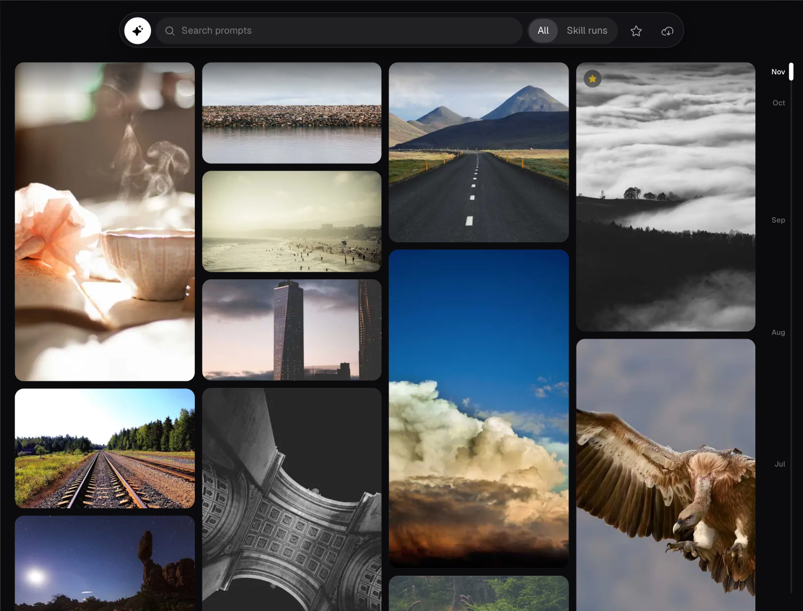
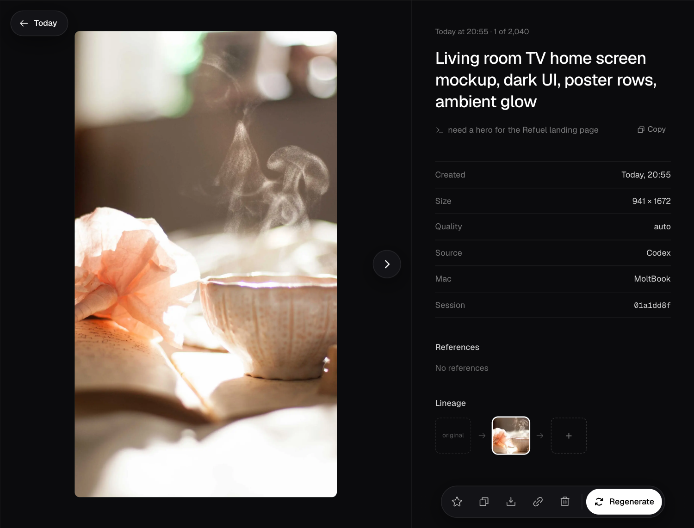
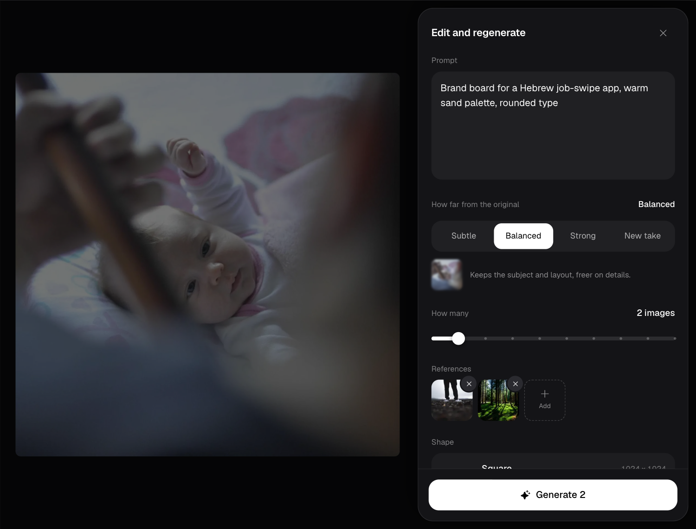

<div align="center">


# codex-image

**Generate images through Codex with your ChatGPT login, and browse every image it ever made.**

[](#install)
[](LICENSE)
[](#requirements)

[Install](#install) &middot; [Generate](#generate) &middot; [Gallery](#gallery) &middot; [How it works](#how-it-works)

</div>

Two skills in one plugin:

- **`generate`** runs the Codex CLI's built-in image tool through a small Python runner. It stages
  reference images, runs Codex once, checks every PNG with Pillow and publishes the files without
  overwriting anything. No API key and no tokens to handle: it uses the ChatGPT login Codex already has.
- **`gallery`** is a private web app for every image Codex has made on your Mac, whether it came
  from this skill or from any other Codex session. Search the prompts, star, delete, regenerate with
  changes, upscale, and send yourself a link to one image. With Tailscale it opens on your phone too.

<p align="center">

<br><sub>The gallery: every image at its real proportions, a floating island for search and filters, and a month timeline to scrub.</sub>
</p>

## Requirements

- macOS or Linux.
- Python **3.10+** with [Pillow](https://pypi.org/project/Pillow/). The gallery reads Codex's
  compressed session logs (`.jsonl.zst`) with the standard library's `compression.zstd`, so prompts
  for those sessions need Python **3.14+**; on older versions those images still show, without a prompt.
- [Codex CLI](https://github.com/openai/codex) signed in with ChatGPT (`codex login`).
- Optional: [Tailscale](https://tailscale.com) to open the gallery on your other devices, and SSH
  access to your other Macs to import their images.

If Pillow is missing, keep it out of your system Python:

```bash
python3 -m venv "$HOME/.cache/codex-image/venv"
"$HOME/.cache/codex-image/venv/bin/python" -m pip install Pillow
```

Then run the scripts with that Python. Nothing here installs dependencies or changes your login for you.

## Install

<details open>
<summary><strong>Claude Code (plugin)</strong></summary>

```text
/plugin marketplace add Dananz/codex-image
/plugin install codex-image@codex-image
```

Then use `/codex-image:generate` and `/codex-image:gallery`, or just ask ("make an app icon",
"open the gallery").

</details>

<details>
<summary><strong>Claude Code or Codex (clone as a skill)</strong></summary>

```bash
git clone https://github.com/Dananz/codex-image ~/.claude/skills/codex-image   # Claude Code
git clone https://github.com/Dananz/codex-image ~/.agents/skills/codex-image   # Codex
```

The root `SKILL.md` is the generate skill (`/codex-image`, or `$codex-image` in Codex), and
`agents/openai.yaml` is optional Codex UI metadata. Install the whole folder: `SKILL.md` alone
does not work. The gallery runs from the same checkout (see [Gallery](#gallery)).

</details>

Use one install per Mac. With both, the same runner shows up twice, as `/codex-image` and
`/codex-image:generate`.

## Generate

```bash
python3 <root>/scripts/generate.py --help

# a new image
python3 <root>/scripts/generate.py --quality high -- 'A minimal emerald green app icon'

# an edit, with a reference image
python3 <root>/scripts/generate.py --input '/path/to/photo.png' \
  -- 'Replace only the background with pale green. Preserve the person and lighting.'
```

`<root>` is the plugin or clone folder. Pass one `--input` per reference and name each one's role
in the prompt. Use `--prompt-file` for long prompts, `-n` for up to 10 images, `--out` for where they
land. The runner prints JSON with `status`, `outputs`, `warnings` and `errors`. If a run is
interrupted, `--collect <run_dir>` recovers what already exists before you generate again.

[SKILL.md](SKILL.md) holds the agent-facing instructions and [references/usage.md](references/usage.md)
every option, exit code and recovery path.

<details>
<summary>On model verification</summary>

The target backend is **ChatGPT Images 2.5**. The runner keeps your configured Codex agent model and
never passes an image model to `codex --model`. The image backend may not expose a selector or its
own identity, so `image_model.verified` in the result stays `null`; an agent-reported model is
separate, unverified information and is never described as verified Images 2.5. `--size` and
`--quality` are requests, not guarantees: the runner measures the real dimensions instead of
resizing to hide a difference. Codex paints each shape at one size (about 1672 px on the long side
at most); larger output comes from the gallery's upscale.

</details>

## Gallery

```bash
python3 <root>/gallery/server/cli.py start
```

```text
Gallery started.
Tailnet: https://<your-mac>.<tailnet>.ts.net:8445/
Local:   http://127.0.0.1:8765/
```

The first start indexes `~/.codex` (about a minute for a few thousand images); the page fills in
while it runs. Later starts take a fraction of a second.

### What you can do

- **Browse:** a virtualized masonry grid of every image at its real proportions, newest first, with
  a month timeline on the side to scrub through months. Only what is on screen loads.
- **Search and filter:** search every prompt, switch between all images and skill runs, show only starred.
- **Image pages:** the prompt (long skill prompts fold), the message that asked for it, size,
  quality, source, Mac and session, the reference images (marked "missing" when the original file
  is gone), and lineage: what it was made from and what was made from it. Arrow keys or a swipe move
  to the next image.
- **Share one image:** every image has a short link, `/i/<short>`. Opening it shows that image;
  Back returns to the gallery scrolled to it, highlighted.
- **Regenerate:** edit the prompt, choose how far to move from the original (Subtle, Balanced,
  Strong or New take), how many to make (1 to 10), the shape (Tall to Wide), add references, and
  upscale 2x or 4x. New images appear live as they finish, linked to their parent.
- **Star, copy, download, delete:** delete moves only Codex's own copy to a trash kept for
  24 hours, with Undo. Copies the runner published elsewhere stay.
- **Import from your other Macs:** copy another Mac's images and prompts over SSH. The menu shows how
  many are new on each Mac, and which are offline.
- **Server info:** the logo opens where the gallery is served from, what it reads, the link to copy,
  the idle timer and a Stop button.

<p align="center">

<br><sub>An image page, at its own short link.</sub>
</p>

<p align="center">

<br><sub>Regenerate: a drawer from the side on desktop, from the bottom on a phone.</sub>
</p>

### Commands

| Command | Does |
| --- | --- |
| `start` | Index, serve in the background, share on your tailnet, print the links. Reuses a running server. |
| `start --forever` | No idle stop (default: stops after 4 hours without a request; `--idle 2h` sets another limit). |
| `start --no-tailscale` | This Mac only. Also `--port N` (default 8765) and `--foreground`. |
| `status` | Running or not, the links, idle time left. |
| `stop` | Stop the server and remove its `tailscale serve` entry. |
| `index --full` | Rebuild the index without serving. |
| `import <host>` | Copy another Mac's images, as the menu does. |

Hosts for import live in `~/.codex-image/config.json`:

```json
{ "hosts": [{ "name": "MoltBook", "ssh": "you@m1" }, { "name": "Laptop", "ssh": "you@laptop" }] }
```

### Privacy

Everything stays on your machines. The server listens on `127.0.0.1` and is shared only with
`tailscale serve` (your tailnet; never Funnel, never the public internet). It only ever adds and
removes its own `:8445` entry, so your other `tailscale serve` entries are left alone. It reads
`~/.codex` without changing it; the one exception is Delete, which moves Codex's copy into the trash.

## How it works

The gallery is a Python server (standard library plus Pillow) and a prebuilt React app.

- **Index:** it reads `~/.codex/generated_images` and the `image_gen.generation` events in Codex's
  session logs (`~/.codex/sessions`, `archived_sessions`) for each image's prompt, references and
  time. A session started inside a `.codex-image-runs/<run>/work` folder is a skill run, and its run
  folder supplies the prompt and settings. Identical pictures are one image, keyed by content hash.
  Logs are read incrementally, so only new lines are read again.
- **Its own data** lives in `~/.codex-image/` (`CODEX_IMAGE_HOME` moves it): `gallery.db` (SQLite),
  WebP thumbnails, copies of references while their originals exist, uploads, regenerated images,
  the trash, imported Macs and Real-ESRGAN.
- **Regenerate** runs `scripts/generate.py` (at most two at a time) with the source image as the
  first reference unless you pick New take. **Upscale** runs
  [Real-ESRGAN](https://github.com/xinntao/Real-ESRGAN) `realesrgan-x4plus` locally, downloaded into
  `~/.codex-image/bin` the first time; it keeps the picture exactly as painted, and fine textures
  can come out a little smooth.
- **Live:** new images, finished jobs and deletes reach open pages over Server-Sent Events.

The full API and data layout are in [docs/gallery-api.md](docs/gallery-api.md).

## Development

```text
SKILL.md                  generate skill (clone install)
skills/generate/SKILL.md  generate skill (plugin)
skills/gallery/SKILL.md   gallery skill (plugin)
scripts/generate.py       the runner
gallery/server/           index, API, jobs, CLI
gallery/web/              React app source (Vite, Tailwind, Base UI, TanStack Virtual)
gallery/dist/             its build, committed
.claude-plugin/           plugin and marketplace manifests
```

```bash
python3 -m unittest discover -s scripts -p 'test_*.py'   # runner
python3 -m unittest discover -s gallery/tests            # gallery server
cd gallery/web && pnpm install && pnpm build             # rebuild the app into gallery/dist
```

`pnpm mock` in `gallery/web` runs the app against a fake API. Issues and pull requests are welcome.

## Origin

Started from [wjb127/codex-image](https://github.com/wjb127/codex-image) (MIT) and rewritten: the
prompt-only skill became a Python runner with tests, reference docs and a Codex agent manifest, and
then a plugin with the gallery. The original MIT license is kept in [LICENSE](LICENSE).

## License

[MIT](LICENSE). Original work © wjb127; changes and the gallery by Tomer Danan.
